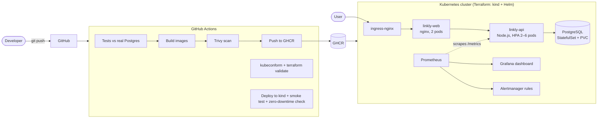

# k8s-devops-platform

A production-style delivery platform for a containerised web application: **Docker → GitHub Actions → Kubernetes**, with **infrastructure as code (Terraform)**, **observability (Prometheus + Grafana)**, **security hardening** and **zero-downtime deployments** that are verified automatically on every push.

The workload is **Linkly**, a small URL shortener (TypeScript API + PostgreSQL + nginx front end). It is deliberately simple — the point of this repository is everything around it: how it is built, tested, shipped, secured, scaled and observed.

> Built by [Mohamed Merouane](https://www.mohamedmerouane.me) — final-year Information Systems engineering student (ENSIASD).

---

## Architecture



| Layer | What's in it |
|---|---|
| **Application** | Express 5 + TypeScript API, PostgreSQL, Prometheus RED metrics, structured JSON logs (pino), graceful `SIGTERM` shutdown, 9 integration tests |
| **Containers** | Multi-stage Dockerfiles, non-root users, production-only deps, `HEALTHCHECK`, unprivileged nginx |
| **Kubernetes** | Kustomize base + `dev` / `prod` overlays · Deployments with rolling updates (`maxUnavailable: 0`) · startup / liveness / readiness probes · HPA · PodDisruptionBudget · topology spread · StatefulSet for Postgres |
| **Security** | `restricted` Pod Security Standard enforced on the namespace · read-only root filesystems · all Linux capabilities dropped · seccomp · default-deny NetworkPolicies (ingress → web → api → db only) · Trivy image scanning in CI · `/metrics` not exposed publicly |
| **Infrastructure as code** | Terraform: kind cluster (1 control plane + N workers), ingress-nginx, metrics-server, kube-prometheus-stack |
| **Observability** | ServiceMonitor, PrometheusRule (error rate, p95 latency, API down — each linked to the runbook), Grafana dashboard as code |
| **CI/CD** | 5 GitHub Actions jobs — see below |

## The pipeline

Every push runs [`.github/workflows/ci.yml`](.github/workflows/ci.yml):

1. **API tests** — typecheck + integration tests against a real PostgreSQL service container.
2. **Validate manifests** — renders both Kustomize overlays and the monitoring stack, validates them against Kubernetes and CRD schemas with `kubeconform -strict`.
3. **Terraform** — `fmt -check` and `validate`.
4. **Build, scan & publish** — builds both images with layer caching, fails on any fixable **CRITICAL** CVE (Trivy), pushes `:sha` and `:latest` tags to GHCR on `main`.
5. **Deploy to Kubernetes** — creates a real kind cluster, deploys the `dev` overlay under the restricted Pod Security Standard, runs an end-to-end [smoke test](scripts/smoke-test.sh), then **restarts the API under continuous traffic and fails if a single request errors** — proving the rolling-update + readiness + `preStop` + graceful-shutdown chain actually gives zero downtime.

## Verification status

| Check | Result |
|---|---|
| API integration tests (Vitest + real PostgreSQL 16) | ✅ 9 / 9 passing |
| Graceful shutdown on `SIGTERM` (manual run) | ✅ readiness drops, in-flight requests finish, clean exit |
| Kustomize render + `kubeconform -strict` (dev, prod, monitoring) | ✅ 37 / 37 resources valid |
| Image build, Trivy scan, Terraform validate, kind e2e + zero-downtime test | ⏳ defined in [`ci.yml`](.github/workflows/ci.yml); runs on GitHub Actions or locally with `make cluster deploy smoke` |

## Run it locally

**Just the app** (Docker Compose):

```bash
docker compose up --build
open http://localhost:8080
```

**The full platform** (Terraform + kind):

```bash
make cluster          # terraform apply: kind cluster + ingress + metrics-server + monitoring
make deploy           # build images, load them into kind, kubectl apply -k k8s/overlays/dev
make monitoring       # ServiceMonitor, alerts, Grafana dashboard
open http://linkly.localtest.me
make grafana          # http://localhost:3000  (admin / admin)
make destroy
```

Requirements: Docker, kubectl, kind, Terraform ≥ 1.6.

## Repository layout

```
app/api/            TypeScript API, tests, Dockerfile
app/web/            nginx front end (static UI + reverse proxy)
k8s/base/           Deployments, Services, HPA, PDB, StatefulSet, Ingress, NetworkPolicies
k8s/overlays/dev    1 replica, CI image tags, debug logging
k8s/overlays/prod   3–10 replicas, bigger resources, TLS via cert-manager
k8s/monitoring/     ServiceMonitor, PrometheusRule, Grafana dashboard JSON
infra/terraform/    kind cluster + Helm releases
scripts/            smoke test
docs/               architecture decisions, runbook
```

## Design decisions

See [`docs/architecture.md`](docs/architecture.md) for the reasoning behind the main choices (Kustomize vs Helm for the app, probes design, why liveness never checks the database, secrets handling, what changes for a real cloud deployment) and [`docs/runbook.md`](docs/runbook.md) for what to do when an alert fires.

## License

MIT © Mohamed Merouane
